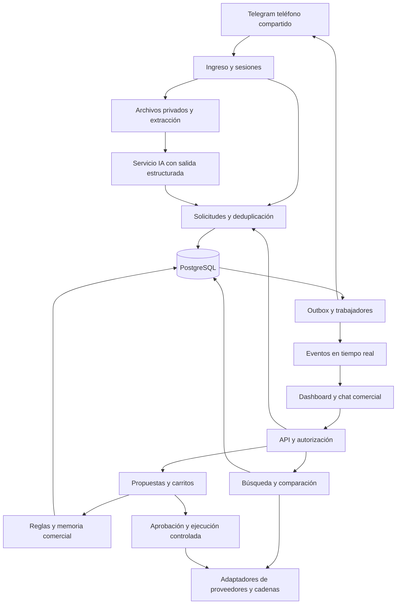

# Farmacia Parque Lantaño — Asistente de compras con IA
## Especificación integral HLD + LLD y contrato de implementación

**Versión:** 1.0 · **Fecha:** 27 de octubre de 2026 · **Idioma:** español de Chile · **Moneda inicial:** CLP · **Zona horaria operativa:** America/Santiago.

**Destino:** equipo de desarrollo y Claude. Documento autocontenido para diseñar, implementar y probar un demo funcional y evolucionarlo a producción sin perder las reglas de negocio.

---

## 0. Cómo usar este documento y fidelidad a la conversación

Este documento consolida el pedido explícito del usuario y los mensajes recuperables de la conversación «Sistema comparador de proveedores», identificador `6ae0ec57-f850-83ea-98ca-7a2247371f44`.

**Limitación de origen:** la consulta de la conversación devolvió cinco turnos recientes y ninguna página anterior; varias respuestas del asistente contienen únicamente marcadores de referencia, sin su texto. Por tanto, no se afirma haber recuperado todos los detalles históricos. Todos los temas enumerados en el pedido actual se incorporan como requisitos; los detalles de implementación adicionales se identifican como propuestas y los datos comerciales desconocidos se mantienen pendientes. Este archivo no certifica acuerdos que no se pudieron leer.

### 0.1 Clases de afirmaciones

- **R — Requisito confirmado:** expresado en el pedido actual o en los mensajes visibles del usuario.
- **P — Propuesta técnica:** decisión recomendada para que la implementación sea concreta; reemplazable por una alternativa equivalente si se documenta la razón y se preservan los requisitos.
- **V — Por validar:** información que requiere al dueño del proceso, al proveedor o una prueba real. No debe inventarse.

Las reglas normativas de negocio de este documento derivan de R. Los valores por defecto, umbrales, esquemas y tecnologías son P salvo indicación explícita. Una propuesta no debe presentarse al negocio como una decisión ya tomada en la conversación.

### 0.2 Instrucciones de continuidad para Claude

1. Leer el archivo completo antes de implementar. Mantener una matriz requisito → implementación → prueba.
2. Conservar los invariantes de la sección 2; no simplificarlos para acelerar el demo.
3. Implementar una vertical funcional: Telegram → identificación → solicitud compartida → deduplicación → dashboard.
4. Después conectar búsqueda y comparación verificables, propuestas, carritos y aprobaciones.
5. Nunca presentar resultados simulados como conectores reales, precios vigentes, pedidos enviados o compras efectivas.
6. No inventar proveedores, credenciales, condiciones comerciales, integraciones, nombres de cadenas ni reglas aprobadas.
7. Las propuestas técnicas pueden ajustarse con una decisión registrada; las reglas comerciales se cambian mediante el flujo autorizado.
8. Si un dato comercial falta, conservarlo como desconocido y permitir avanzar donde sea seguro. Preguntar solo lo necesario en el punto adecuado.
9. No habilitar compras reales hasta cumplir los controles de producción y contar con autorización explícita para el pedido específico.
10. Antes de entregar: demostrar los criterios de aceptación, documentar limitaciones y actualizar este archivo con decisiones nuevas.

---

# PARTE I — PRODUCTO, REQUISITOS E INVARIANTES

## 1. Objetivo y alcance

Construir un asistente de compras para Farmacia Parque Lantaño que reemplace el registro informal en papel por una lista compartida, permita reportar faltantes desde Telegram y ayude a la encargada de compras a buscar productos, comparar proveedores, preparar pedidos y ejecutar compras controladas.

La IA interpreta lenguaje e imágenes, propone equivalencias y explica recomendaciones. Las cantidades, precios, elegibilidad, permisos, aprobaciones y transacciones se resuelven con reglas y operaciones deterministas auditables.

### 1.1 Resultado esperado del demo

Un auxiliar usa Telegram en el teléfono compartido, se identifica y escribe «falta ibuprofeno de 400». La solicitud aparece en el dashboard. Otro auxiliar reporta lo mismo: el sistema reconoce la necesidad existente, registra una nueva observación y no crea otra línea ni aumenta automáticamente la cantidad. La encargada revisa lo pendiente, completa detalles, busca ofertas y prepara una propuesta. Se distinguen de forma visible las fuentes reales y los datos de demostración.

### 1.2 Actores

| Actor | Función | Restricciones principales |
|---|---|---|
| Auxiliar | Reportar faltantes, adjuntar fotos, consultar lista compartida, corregir su reporte | No compra ni cambia reglas comerciales globales |
| Encargada de compras | Resolver ambigüedades, definir cantidades, comparar, editar propuestas y carritos | Solo aprueba o compra si tiene esos permisos explícitos |
| Aprobador | Autorizar una versión concreta de un pedido | Sin aprobación implícita por conversación informal |
| Administrador | Gestionar usuarios, conectores, permisos y configuración | El rol no implica automáticamente permiso de compra |
| Servicio de integración | Leer catálogos y ejecutar operaciones autorizadas | Credenciales y permisos mínimos por conector |
| Auditor | Consultar trazabilidad | Acceso de solo lectura a información autorizada |

Una misma persona puede reunir roles, pero los permisos son explícitos. La separación de funciones es configurable.

### 1.3 Registro de requisitos

| ID | Requisito R | Evidencia de cumplimiento |
|---|---|---|
| R01 | Telegram como primer canal, con teléfono compartido | Reportes reales desde el dispositivo de prueba |
| R02 | Identificación del auxiliar independiente de la cuenta Telegram | Autor y sesión visibles en cada reporte |
| R03 | Lista compartida que sustituye el papel | Mismo estado consultable desde Telegram y dashboard |
| R04 | Deduplicación semántica sin sumar cantidades erróneas | Pruebas de repetición, concurrencia y cantidades |
| R05 | Recepción de fotos | Archivo vinculado, extracción revisable y confirmación |
| R06 | Dashboard en tiempo real | Cambios y reconexión sin perder eventos |
| R07 | Búsqueda libre y conectores reales | Consultas verificables con procedencia y fecha |
| R08 | Referencias de cadenas | Comparación separada de referencia pública y costo de proveedor |
| R09 | Comparación estricta | Elegibilidad por presentación, dosis, formato y condiciones |
| R10 | Propuestas masivas por excepciones | Resolución por lote y cola de problemas |
| R11 | Carritos persistentes | Recuperación, versiones y conflictos controlados |
| R12 | Aprobación y compra controlada | Aprobación vinculada a versión y ejecución idempotente |
| R13 | Aprendizaje conversacional, reglas y memoria comercial | Reglas propuestas, confirmadas, versionadas y explicables |
| R14 | UX intuitiva y sencilla | Tareas habituales con acciones claras y lenguaje cotidiano |
| R15 | HLD y LLD completos, seguridad y trazabilidad | Arquitectura, datos, APIs, flujos, pruebas y operación |
| R16 | Demo y producción claramente delimitados | Modos visibles y bloqueos de ejecución |

## 2. Invariantes no negociables

1. **Un nuevo aviso de faltante no es una nueva cantidad.** Repetir «falta X» añade evidencia, no unidades.
2. **Un duplicado técnico no produce ningún efecto adicional.** Reenvíos de Telegram, trabajos y peticiones se procesan idempotentemente.
3. **Una observación y una línea de compra son entidades distintas.** Muchos avisos pueden respaldar una sola necesidad.
4. **Cantidad desconocida no equivale a cero ni a uno.** Debe permanecer nula hasta que se defina, sin convertirla en pedido válido.
5. **No se fusionan automáticamente productos incompatibles.** Dosis, forma, vía, liberación, combinación, contenido y restricciones relevantes cuentan.
6. **Una coincidencia semántica no prueba equivalencia comercial.** La similitud de texto sirve para encontrar candidatos.
7. **El precio más bajo solo gana entre ofertas elegibles y comparables.** Información incompleta no se convierte en una oferta ganadora silenciosa.
8. **Referencia de cadena no significa oferta comprable del proveedor.** Se mantienen objetivos, condiciones y fuentes separados.
9. **La IA no autoriza compras ni modifica cantidades por inferencia.** Los comandos ambiguos se proponen para confirmación.
10. **Aprobar significa aprobar una versión concreta.** Cambiar producto, cantidades, precio, condiciones, dirección o proveedor invalida la aprobación afectada.
11. **Un clic de envío no prueba una compra.** Se requiere confirmación del proveedor o conciliación posterior.
12. **Una respuesta incierta no se reintenta como una compra nueva.** Se bloquea y concilia antes de otra ejecución.
13. **No hay conectores supuestamente reales.** Cada resultado informa origen, modo y momento de observación.
14. **Una preferencia conversacional no se vuelve regla global sin validación.** Alcance y vigencia deben ser explícitos.
15. **El teléfono compartido no identifica a una persona por sí solo.** Cada operación conserva identidad declarada/verificada y su nivel de confianza.
16. **La lista y las operaciones son propias de la farmacia.** No se mezclan datos entre organizaciones ni entre ciclos históricos cerrados.

## 3. Casos de uso y UX

### 3.1 Telegram en teléfono compartido

**R:** el flujo debe funcionar aunque todos utilicen una misma cuenta y dispositivo Telegram. El `telegram_user_id` identifica la cuenta técnica, no al auxiliar.

**P:** conversación privada con el bot en el teléfono compartido; grupo autorizado opcional si el negocio lo necesita. La topología definitiva es V.

Al iniciar, después de expirar la sesión o cuando se pulse «Cambiar auxiliar», el bot solicita seleccionar un auxiliar habilitado. Para autenticación atribuible en producción, se propone un PIN personal o mecanismo equivalente. La selección sin PIN en demo queda marcada como «identidad declarada». No representa una firma ni autorización de compra.

La cabecera y cada confirmación muestran «Reportando como: Ana · Cambiar». Las sesiones expiran por inactividad; valor inicial propuesto: 10 minutos, configurable tras probarlo en la farmacia. El sistema no puede detectar físicamente el cambio de persona: ese límite debe explicarse y mitigarse con cambio rápido, expiración y confirmación visible de identidad.

Botones iniciales: **Reportar faltante**, **Ver lista**, **Enviar foto**, **Cambiar auxiliar**. Texto libre siempre disponible. No pedir comandos técnicos al usuario.

Si llega un mensaje sin identidad vigente: guardar la recepción pendiente sin crear demanda atribuida, solicitar identificación y vincular solo mensajes de esa sesión pendiente. No atribuir mensajes antiguos o de otra conversación automáticamente. Permitir descartar.

### 3.2 Lista compartida

La lista activa muestra nombre comprensible, variante conocida, cantidad objetivo si existe, estado, última observación y número de reportes. Desde Telegram debe poder consultarse por búsqueda y páginas; no depender exclusivamente de un mensaje fijado que puede quedar obsoleto.

Ejemplo:

> Ibuprofeno 400 mg · presentación por definir · cantidad pendiente · ya reportado por Ana y Luis · en revisión.

Si se repite:

> Ya está en la lista. Registré tu aviso; la cantidad no cambió. [Ver detalle] [Definir cantidad]

El auxiliar puede sugerir cantidad; su aplicación efectiva depende de permisos. Los reportes no se borran para ocultar errores: se corrigen o anulan con historial.

### 3.3 Dashboard

Vista inicial con tres áreas sencillas: **Faltantes**, **Propuesta de compra**, **Pedidos**. Búsqueda libre visible y chat de asistencia accesible. La gestión de reglas, conectores y auditoría queda en configuración.

En faltantes: indicadores «Por aclarar», «Listos para buscar» y «En pedido»; filtros simples, acciones por lote y detalle progresivo. No mostrar todos los campos técnicos en la tabla principal.

En propuesta: resumen por proveedor, costo estimado, excepciones que requieren decisión y acción «Revisar pedido». No forzar a abrir cada línea correcta.

En pedidos: carritos guardados, aprobación pendiente, ejecución en curso, confirmados y situaciones por conciliar.

Tiempo real con estado «Actualizado hace…», indicador de reconexión y recarga de respaldo. Una conexión caída nunca debe parecer una lista vacía.

### 3.4 Chat comercial

Ejemplo confirmado en la conversación: «Necesito que el precio del ibuprofeno sea entre 1.000 y 1.200 pesos, no más».

Respuesta correcta: proponer una regla y aclarar su base cuando falte: ¿precio de compra por caja, unidad u otra presentación?, ¿con IVA?, ¿para qué variante?, ¿solo esta compra o futuras? La frase por sí sola no permite fijar una restricción global para todos los ibuprofenos.

La UI presenta una tarjeta editable: producto, rango, moneda, base, impuestos, alcance, vigencia y efecto. Después de confirmar por usuario autorizado, la regla entra en vigor y las recomendaciones muestran por qué aplica.

**P:** si se confirma un rango inclusivo [1.000, 1.200], no recomendar automáticamente precios fuera del rango. El significado del límite inferior se valida: puede representar un rango obligatorio o una alerta de anomalía; no se presume que una oferta más barata deba rechazarse. El máximo «no más» se conserva como tope duro si así se confirma.

### 3.5 Accesibilidad y facilidad

Diseño móvil y escritorio, contraste legible, navegación con teclado, foco visible, etiquetas para lectores de pantalla, botones de buen tamaño y acciones que no dependan solo de colores. Idioma cotidiano: «Falta cantidad», «Precio sin actualizar», «Revisar presentación». Evitar jerga de IA y pantallas saturadas.

Los formularios conservan el trabajo al volver atrás. Las acciones reversibles admiten deshacer; las consecuencias económicas muestran un resumen específico antes de autorizar. Los errores dicen qué ocurrió y qué puede hacerse.

---

# PARTE II — HLD: ARQUITECTURA DE ALTO NIVEL

## 4. Arquitectura propuesta

**P:** monolito modular con trabajadores asíncronos para empezar. Evitar microservicios hasta que volumen, aislamiento o equipo lo justifiquen.



### 4.1 Módulos y límites

| Módulo | Responsabilidad | No puede hacer |
|---|---|---|
| Ingreso | Webhooks, mensajes, identidad y adjuntos | Comprar o inferir autor desde el dispositivo |
| Demanda | Lista compartida, observaciones, cantidades y ciclos | Sumar repetidos o decidir sustituciones clínicas |
| Catálogo | Identidades y equivalencias comerciales verificadas | Convertir similitud en equivalencia definitiva |
| IA | Extraer, clasificar, proponer y explicar | Ejecutar SQL libre, aprobar o poseer credenciales |
| Fuentes | Búsqueda y normalización con procedencia | Ocultar datos ausentes o simular disponibilidad |
| Comparador | Elegibilidad y costos con reglas deterministas | Comparar bases incompatibles sin advertir |
| Planificador | Propuestas por lote y reparto por proveedor | Ejecutar por sí solo |
| Carritos | Persistencia, versiones y reservas internas | Tomar estado local como confirmación externa |
| Reglas | Políticas versionadas y memoria comercial | Autoaprobar preferencias inferidas |
| Ejecución | Validación final, envío y conciliación | Reintentar ciegamente resultados inciertos |
| Auditoría | Trazabilidad de acciones y decisiones | Exponer secretos o alterar hechos registrados |

### 4.2 Stack de referencia P

- Web: TypeScript y React/Next.js o equivalente, componentes accesibles y diseño adaptable.
- API: TypeScript con un framework modular; validación de entrada y contratos OpenAPI.
- Base transaccional: PostgreSQL; índices de texto y vectoriales si aportan valor medido.
- Archivos: almacenamiento privado compatible con S3, enlaces temporales.
- Trabajos: cola durable; en fase inicial, tabla de trabajos/outbox en PostgreSQL. Redis opcional para coordinación y caché, no como única fuente de verdad.
- Eventos de UI: SSE; WebSocket solo si se necesita bidireccionalidad adicional. Las mutaciones usan API HTTP.
- IA: adaptador de proveedor de modelos con salidas estructuradas y límites de costo; OCR/visión desacoplados.
- Infraestructura: servicios administrados donde sea conveniente, despliegues separados demo/staging/producción y migraciones versionadas.

No hay proveedor cloud, versión de framework ni modelo de IA acordados. Verificar documentación vigente y compatibilidad al implementar.

### 4.3 Fuentes de verdad

- Demanda, cantidades, permisos, reglas, aprobaciones y auditoría: base local transaccional.
- Precio y stock observados: capturas fechadas del proveedor, con expiración; nunca garantía indefinida.
- Pedido externo: confirmación del proveedor y conciliación.
- Carrito local: intención persistente; puede diferir de un carrito remoto.
- Memoria comercial: hechos con procedencia y reglas confirmadas; no el historial crudo del modelo.

## 5. Estrategia de conectores reales

### 5.1 Tipos y capacidades

Cada conector declara capacidades efectivas: `search`, `product_detail`, `price`, `stock`, `terms`, `remote_cart`, `submit_order`, `order_status`, `cancel_order`. Ausencia de capacidad significa función deshabilitada, no imitación.

Prioridad propuesta: API oficial/autorizada → catálogo o archivo acordado → integración asistida permitida por el proveedor. Automatización de navegador solo si es necesaria, autorizada y evaluada; no eludir CAPTCHA, MFA ni restricciones. Una web pública no implica permiso ni capacidad para comprar automáticamente.

Conectores de referencia de cadenas se separan de los proveedores comprables. Los nombres de cadenas y proveedores, acceso comercial, documentación y condiciones son V.

### 5.2 Contrato común

```typescript
type SourceMode = 'live' | 'sandbox' | 'fixture' | 'manual_import';
interface Connector {
  capabilities(): Capability[];
  search(input: SearchInput, ctx: ConnectorContext): Promise<SearchPage>;
  getOffer(input: OfferRef, ctx: ConnectorContext): Promise<OfferSnapshot>;
  validateCart?(input: CartSnapshot, ctx: ConnectorContext): Promise<ValidationResult>;
  submitOrder?(input: ApprovedOrderSnapshot, ctx: ExecutionContext): Promise<SubmissionResult>;
  getOrderStatus?(input: ExternalOrderRef, ctx: ConnectorContext): Promise<OrderStatusResult>;
}
```

Toda respuesta contiene `source_id`, `mode`, `observed_at`, `external_id`, base de precio, moneda, estado de impuestos, enlace/evidencia permitida, stock conocido o desconocido, errores parciales y procedencia. El adaptador conserva un hash y, según política, una copia sanitizada de la evidencia original.

Errores tipificados: credenciales vencidas, límite de consultas, fuente caída, formato cambiado, producto ausente, stock desconocido y precio no disponible. Un fallo de proveedor no devuelve «sin ofertas» como si la búsqueda hubiera sido completa.

### 5.3 Búsqueda libre

Aceptar nombres, dosis, marca/laboratorio, códigos y descripciones naturales. Buscar en catálogo local y fuentes habilitadas; devolver candidatos con filtros y estado de cada fuente. El usuario puede buscar sin crear una solicitud de faltante.

La expansión por sinónimos ayuda a encontrar resultados, pero no elimina restricciones. Una búsqueda de «ibuprofeno 400» no rellena por defecto caja, laboratorio ni cantidad. Conservar la consulta original junto a la interpretación.

### 5.4 Frescura y límites

`fresh_until` depende de fuente y campo. Precio, stock y términos pueden tener vigencias distintas. Valores concretos son V/P configurables por conector. Toda compra revalida información crítica inmediatamente antes de enviar, aunque la caché aún parezca vigente.

Aplicar tiempo máximo, reintentos con espera aleatoria para lecturas seguras, circuit breaker, concurrencia por proveedor y registro de cambios de esquema. No repetir mutaciones externas sin mecanismos de idempotencia o conciliación.

---

# PARTE III — LLD: MODELO, REGLAS Y CONTRATOS

## 6. Modelo de datos

Convenciones P: UUID como identificador; fechas UTC con zona operativa al presentar; `organization_id` en entidades de negocio; `version` entero para concurrencia optimista; borrado lógico o eventos de anulación donde exista auditoría. Importes con decimal exacto y moneda, nunca coma flotante binaria. Cantidades con decimal y unidad explícita. No asumir CLP en cálculos porque la configuración inicial sea CLP.

### 6.1 Identidad, ingreso y demanda

| Entidad | Campos principales y significado |
|---|---|
| `organization` | nombre, zona horaria, moneda, políticas |
| `user` / `role_binding` | persona, estado, roles y permisos por organización |
| `auxiliary_profile` | nombre visible, vínculo a usuario si existe, hash PIN si aplica |
| `channel_binding` | bot/chat autorizado, organización, tipo privado/grupo, modo compartido |
| `actor_session` | canal, auxiliar, nivel de identidad, inicio, última actividad, expiración, revocación |
| `inbound_event` | proveedor, clave única externa, payload sanitizado/hash, recepción, estado y reintentos |
| `message` | chat, id externo, texto original, sesión, autor, edición y correlación |
| `attachment` | archivo privado, MIME verificado, tamaño, hash, estado de análisis y retención |
| `extraction` | mensaje/adjunto, campos, confianza por campo, modelo/versión, evidencia y correcciones |
| `purchase_cycle` | ciclo/lista, estado abierto/cerrado, apertura, cierre y responsable |
| `demand_item` | ciclo, identidad comercial parcial o resuelta, estado, cantidad objetivo nullable, unidad, versión |
| `demand_observation` | línea, mensaje, autor, intención, texto original y cantidad declarada sin aplicación implícita |
| `quantity_event` | línea, operación, valor, antes/después, autor, razón, confirmación e idempotencia |
| `merge_decision` | candidatos, resultado, evidencia, automático/manual, regla/versión y posibilidad de reversión |

### 6.2 Catálogo y ofertas

| Entidad | Campos principales |
|---|---|
| `product_concept` | principio(s) activo(s), marca si relevante, categoría, sinónimos |
| `trade_item` | concepto, dosis estructurada, forma, vía, liberación, contenido, unidad comercial, laboratorio, códigos verificados |
| `product_alias` | texto/fuente, identidad vinculada, validador y estado |
| `supplier` | datos comerciales, condiciones conocidas y estado |
| `source` / `connector_config` | tipo proveedor/cadena, capacidades, entorno, referencia a secreto y salud |
| `supplier_product_mapping` | SKU externo, trade item, evidencia y verificación |
| `search_run` / `search_source_result` | consulta, filtros, fuentes consultadas, cobertura, fallos y tiempos |
| `offer_snapshot` | SKU, precio, moneda, impuestos, cantidad/base, stock, mínimos, múltiplos, vencimiento/lote si disponible, vigencia y evidencia |
| `shipping_terms_snapshot` | costo por pedido, mínimos, zona, plazo, condiciones y fuente |
| `reference_price` | cadena, variante, precio público, promoción, condiciones y fecha |
| `comparison_run` / `comparison_candidate` | entradas, elegibilidad, razones, costo calculado, versión de reglas |

### 6.3 Planificación, compra y aprendizaje

| Entidad | Campos principales |
|---|---|
| `proposal` / `proposal_line` | demanda cubierta, ofertas elegidas, cantidades, total, excepciones, revisión |
| `cart` / `cart_line` | proveedor, estado, revisión, SKU, snapshot, cantidades y ajustes |
| `demand_allocation` | línea de demanda, carrito/pedido, cantidad asignada, estado reservado/comprometido/liberado |
| `approval_request` / `approval` | snapshot y hash, aprobador, decisión, límites, vigencia y motivo |
| `purchase_execution` | snapshot aprobado, idempotencia, estado, intento y correlación externa |
| `purchase_order` / `purchase_order_line` | referencia proveedor, líneas confirmadas, precio, fechas y estado |
| `receipt` / `receipt_line` | recepción física, aceptado/rechazado, diferencias y responsable |
| `rule` / `rule_version` | predicado, efecto, ámbito, prioridad, dureza, vigencia, estado y aprobador |
| `memory_fact` | hecho/preferencia, fuente, confianza, ámbito, vigencia, confirmado/inferido/obsoleto |
| `conversation` / `conversation_action` | contexto comercial, propuesta estructurada y decisión humana |
| `audit_event` | actor, acción, entidad, antes/después permitido, correlación y fecha |
| `outbox_event` / `job` | evento o tarea durable, intentos, disponibilidad y estado |

### 6.4 Restricciones y relaciones

- Único `inbound_event(provider, channel_binding_id, external_event_id)`.
- Único comando de cantidad por `organization_id + idempotency_key`.
- Línea activa única por ciclo e identidad comercial resuelta: índice parcial sobre `organization_id, cycle_id, resolved_identity_key`, cuando no sea nula y el estado sea activo.
- Las líneas incompletas no reciben una clave ficticia equivalente a producto resuelto; se buscan candidatos y se bloquea su fusión incierta.
- Una observación tiene un destino activo, preservando historial de reasignaciones al fusionar/deshacer.
- `target_quantity` nula o no negativa; unidades compatibles; eventos de suma requieren intención y autorización explícitas.
- Cada aprobación se vincula a un snapshot inmutable. El hash se calcula sobre una representación canónica del servidor.
- Un `purchase_execution` único por snapshot autorizado y operación; no generar otra clave al reintentar la misma acción.
- Las asignaciones no pueden exceder la cantidad objetivo sin una modificación explícita de esa cantidad o autorización de sobrecompra.
- Todos los vínculos comprueban pertenencia a la misma organización; no confiar solo en UUID difíciles de adivinar.

## 7. Identidad de productos y deduplicación semántica

### 7.1 Identidad comercial

Campos relevantes: principio activo o combinación, dosis y denominador, forma, vía, liberación, contenido del envase, unidad comercial, marca/laboratorio cuando se exija y códigos verificados.

Ejemplos de diferencias bloqueantes: 400 mg vs 600 mg; comprimidos vs suspensión; 100 mg/5 mL vs 100 mg/mL; liberación inmediata vs prolongada; un principio activo vs combinación. Caja de 10 y de 20 pueden compartir concepto, pero no son la misma presentación comercial.

El sistema ofrece dos niveles: concepto de faltante todavía incompleto y artículo comercial preciso. No obliga al auxiliar a saber un SKU, pero sí exige suficiente precisión antes de comprar.

### 7.2 Algoritmo propuesto

1. Persistir e identificar el evento técnico. Si ya existe, devolver el resultado anterior.
2. Resolver sesión y conservar texto/archivo original.
3. Extraer intención y atributos mediante esquema validado; mantener campos desconocidos.
4. Normalizar unidades y sinónimos sin perder texto original.
5. Generar candidatos del ciclo activo con búsqueda exacta, léxica y semántica.
6. Descartar candidatos con atributos explícitos incompatibles.
7. Si existe identidad comercial verificada idéntica, asociar observación a la línea correspondiente.
8. Si la descripción parcial coincide con una única necesidad incompleta compatible y no hay ambigüedad material, asociar como aviso repetido según política verificable. Nunca fijar una presentación que el usuario no indicó.
9. Si hay varias variantes o confianza insuficiente, preguntar con opciones breves y conservar la observación pendiente.
10. Si no hay candidato, crear una necesidad parcial o resuelta con cantidad desconocida salvo instrucción explícita confirmada.
11. Confirmar al auxiliar qué se registró y qué pasó con la cantidad.

**P:** no usar un umbral vectorial universal para autofusionar. Calibrar con ejemplos de la farmacia; registrar versión de política, atributos comparados y decisión. Hasta validar precisión, revisión humana de coincidencias semánticas inciertas.

### 7.3 Cantidades: semántica obligatoria

| Mensaje | Resultado |
|---|---|
| «Falta ibuprofeno 400» | Crear o asociar aviso; cantidad queda igual o desconocida |
| Otro auxiliar: «No hay ibuprofeno de 400» | Nuevo aviso en la misma necesidad compatible; no sumar |
| «Necesitamos 5 cajas» | Proponer fijar objetivo a 5 cajas; no añadir 5 a un objetivo existente por defecto |
| «También faltan 5» | Ambiguo: preguntar si son 5 en total o 5 adicionales |
| «Agrega 5 cajas más a las 10» | Operación `ADD 5`, mostrar total 15 y confirmar según permiso |
| «Que sean 8 en total» | Operación `SET 8`, con control de versión |
| «Ibuprofeno 400 x 20» | `x 20` puede ser contenido del envase, no cantidad a comprar |
| «Ya llegó» | Solicitar identificar pedido/recepción; no cerrar toda la demanda automáticamente |

Las acciones de cantidad son `SET`, `ADD` y `CLEAR`, nunca una suma implícita por extracción. El permiso de auxiliar para proponer o aplicar cambios es configurable; por defecto propone y la encargada confirma.

### 7.4 Concurrencia y ciclo de vida

Dos auxiliares pueden enviar el mismo faltante simultáneamente. La transacción usa bloqueo por clave normalizada del candidato/ciclo y la restricción de unicidad cuando existe identidad resuelta. Si hay colisión, se vuelve a leer y se adjunta al existente. Para identidades parciales, una tarea serializada por ciclo y familia candidata o bloqueo transaccional evita crear dos líneas por una carrera; una reconciliación posterior ofrece fusionar, nunca altera cantidades automáticamente.

Una línea comprada/enviada todavía visible no se interpreta automáticamente como demanda adicional. El bot informa «Hay 5 cajas en pedido» y ofrece «Registrar que aún falta» o «Solicitar necesidad adicional». La segunda requiere cantidad y confirmación. Un ciclo cerrado conserva historia; un faltante nuevo en el siguiente ciclo puede crear nueva necesidad.

### 7.5 Fusión y deshacer

La fusión preserva observaciones, autores y eventos. Si dos líneas tienen cantidades definidas, no sumarlas ni elegir el máximo automáticamente: abrir una excepción para decidir el objetivo final. Deshacer restaura asociaciones y exige resolver asignaciones/carritos afectados. No fusionar silenciosamente líneas vinculadas a pedidos ya ejecutados.

## 8. Fotos y extracción

Aceptar fotos de envases, estantería o lista, vinculadas al mensaje y a la identidad. Verificar tipo real, tamaño y archivo; bloquear formatos peligrosos y aplicar análisis de seguridad adecuado.

Flujo: recepción → almacenamiento privado → extracción OCR/visión → candidatos → tarjeta de confirmación → creación/asociación de observaciones. Una foto con varios productos genera varias propuestas de línea bajo un mismo grupo de origen, deduplicadas individualmente.

Extraer marca, principio activo, dosis, forma, contenido y códigos legibles. Mostrar confianza por campo y resaltar dudas. Una foto no determina stock faltante ni cantidad a comprar por el mero número de cajas visibles. Texto OCR, códigos borrosos y etiquetas incompletas requieren verificación.

Si foto y texto discrepan —«400» en mensaje y «600» visible— bloquear resolución automática y preguntar. Para evitar datos innecesarios, recomendar fotos de productos sin pacientes, recetas ni personas; la retención y eliminación son configurables y deben validarse antes de producción.

## 9. Comparación estricta y referencias de cadenas

### 9.1 Puertas de elegibilidad

Antes de ordenar ofertas, comprobar:

1. Identidad comercial exacta o equivalencia expresamente permitida y verificada.
2. Dosis, forma, vía, liberación, contenido y restricciones de marca/laboratorio.
3. Cantidad comercial compatible, mínimo y múltiplo de compra.
4. Moneda y base de precio; impuestos conocidos.
5. Stock suficiente conocido o excepción visible; stock desconocido no equivale a disponible.
6. Precio vigente y condiciones aplicables a la farmacia.
7. Vencimiento mínimo, cadena de frío u otras condiciones cuando sean relevantes y conocidas.
8. Reglas comerciales duras y permisos.

Clasificación: `eligible`, `ineligible`, `needs_review`. Solo `eligible` puede seleccionarse automáticamente. Las otras categorías muestran causas. No recomendar sustituciones clínicas; una alternativa comercial no idéntica requiere política y revisión competente fuera de la inferencia del modelo.

### 9.2 Costos

Para cada línea:

`neto_linea = cantidad_comercial × precio_neto_por_unidad_comercial − descuentos_aplicables`

`total_pedido = suma(netos_linea) + impuestos + despacho + otros_cargos_confirmados − descuentos_pedido`

No restar dos veces descuentos ya incluidos en precio. Cada snapshot declara `tax_included`, `discount_included` y condiciones de promoción. No asumir un porcentaje tributario por defecto sin configuración validada.

Para comparar envases distintos, solo calcular precio por unidad base si contenido, unidad y política lo permiten; no tratarlos como el mismo SKU. Mostrar cantidad comprada resultante y sobrante por redondeo. El costo de despacho se calcula al nivel del pedido; su prorrateo explicativo no modifica el total real.

Si falta despacho u otro costo obligatorio, mostrar total parcial y bloquear la afirmación «más barato total». Si faltan condiciones, permitir exploración, pero no selección automática ni aprobación final.

### 9.3 Cadenas

Las cadenas aportan referencia pública de mercado con nombre, enlace, fecha, producto exacto y condiciones: precio normal/promoción, membresía, medio de pago, canal, despacho y stock si se informa. No comparar un precio condicionado como si fuera universal.

El precio de venta de una cadena no es el costo de adquisición de la farmacia. Sirve para contexto comercial, anomalías y, si se confirma la política, análisis de margen. Un margen requiere precio de venta propio, costos e impuestos compatibles; no inferirlo solo de la referencia.

### 9.4 Explicabilidad

Cada elección responde: qué variante se comparó, qué ofertas se descartaron y por qué, cuánto cuesta la línea/pedido, qué regla influyó, de cuándo son los datos y qué falta. El modelo puede redactar la explicación, pero los números y las razones provienen del motor determinista.

## 10. Propuestas masivas por excepciones

Entrada: conjunto de demandas resueltas, cantidades, ofertas recientes y versión de reglas. Salida: asignación propuesta por proveedor, totales, cobertura y excepciones.

Objetivo P: minimizar costo total elegible y respetar restricciones, con criterios secundarios configurables de plazo, confiabilidad y número de proveedores. No afirmar óptimo global si se usa una heurística. Registrar método, versión y supuestos.

Restricciones: mínimos por proveedor, múltiplos, stock, presupuesto, fecha requerida, condiciones de pago, regla de producto, límites de proveedor y cantidades ya asignadas. No rellenar mínimos con productos no solicitados sin aprobación explícita.

Cada demanda se clasifica en «Lista», «Falta cantidad», «Presentación ambigua», «Sin oferta», «Datos desactualizados», «Fuera de regla», «Mínimo no alcanzado» o «Conflicto». Las listas pueden revisarse por lote; las excepciones reciben acciones específicas.

Permitir «Aplicar propuestas elegibles al carrito» con resumen y versiones. Aplicar un lote modifica carritos locales; no significa aprobar ni comprar. Resolver una excepción recalcula solo lo afectado y mantiene una nueva revisión trazable. Una reoptimización no borra elecciones manuales sin informar y solicitar su reemplazo.

Para lotes grandes, procesar de forma asíncrona con progreso por fuentes/líneas, cancelación y resultados parciales identificados. La aceptación de una revisión no se aplica a una propuesta que cambió en segundo plano.

## 11. Carritos persistentes y cobertura de demanda

Un carrito local por proveedor y contexto de compra, con múltiples carritos permitidos cuando el negocio lo requiera. Se guarda después de cada cambio confirmado, con historial y `version`.

Cada línea conserva SKU, presentación, cantidad comercial, demanda que cubre, oferta de referencia, base tributaria, vigencia y decisión manual si existe. Al recuperar un carrito se muestra lo conservado y se revalidan ofertas; no se reemplazan precios silenciosamente.

Las asignaciones reservan cantidades internas para evitar proponer la misma necesidad en dos carritos. Se liberan al eliminar, cancelar o expirar conforme a política. No confundir reserva interna con reserva de stock del proveedor. La suma de asignaciones concurrentes se valida transaccionalmente.

Edición concurrente: API exige versión; conflicto devuelve la revisión actual y permite comparar cambios. Nunca «último en guardar gana» para cantidades o pedidos.

Si existe carrito remoto, conservar identificador y último estado sincronizado. Las diferencias se muestran antes de enviar. Un carrito remoto vencido no elimina la intención local.

## 12. Aprobación, compra y conciliación

### 12.1 Estados

```text
Carrito:
DRAFT → VALIDATING → READY_FOR_APPROVAL → APPROVAL_PENDING → APPROVED
APPROVED → EXECUTING → SUBMITTED → CONFIRMED
EXECUTING → FAILED_SAFE | UNKNOWN
APPROVAL_PENDING → REJECTED → DRAFT
Cualquier edición material antes de ejecutar → DRAFT + aprobación invalidada
UNKNOWN → RECONCILING → CONFIRMED | FAILED_SAFE | NEEDS_HUMAN_REVIEW
```

`SUBMITTED` significa recepción técnica del envío; `CONFIRMED` exige evidencia externa de aceptación y detalle. `FAILED_SAFE` solo cuando hay evidencia de que no se creó el pedido. Cancelar o recibir pertenece al ciclo del pedido y requiere confirmación apropiada; no reescribirlo como carrito sin historia.

Estados de pedido propuestos: confirmado, parcialmente confirmado, en despacho, parcialmente recibido, recibido, cancelación solicitada, cancelado y con diferencias. La recepción física no se presume de la confirmación de compra.

### 12.2 Secuencia controlada

1. Validar todas las líneas, cantidades, reglas y costos obligatorios.
2. Congelar snapshot canónico: proveedor, cuenta, SKUs, cantidades, moneda, precios, impuestos, cargos, pago, entrega y condiciones.
3. Mostrar resumen y solicitar aprobación a un usuario autorizado.
4. Guardar decisión, hash, versión, identidad fuerte, vigencia y motivo.
5. Antes del envío, autenticar permiso de ejecución y revalidar datos críticos con el proveedor.
6. Si cambia un dato material, invalidar aprobación y presentar nuevo resumen. P inicial: tolerancia monetaria cero; cualquier tolerancia futura requiere política expresa.
7. Adquirir bloqueo, crear ejecución única, verificar aprobación vigente y que ninguna otra ejecución la haya consumido.
8. Enviar con clave de idempotencia estable si el proveedor la soporta.
9. Guardar evidencia y referencia externa; notificar resultado correcto, parcial o incierto.
10. Conciliar estado externo; actualizar asignaciones comprometidas y excepciones.

Si la revalidación y la compra no pueden ser atómicas en el proveedor, documentar ese riesgo y usar cotización/checkout fijado cuando exista. Una aprobación local no garantiza que el proveedor respete precios anteriores.

### 12.3 Fallos delicados

- Timeout después de enviar: marcar `UNKNOWN`, impedir otro envío y consultar estado externo.
- Proveedor sin idempotencia ni consulta confiable: dejar ejecución asistida/manual; no prometer compra automática segura.
- Confirmación parcial: comprometer solo líneas confirmadas; mantener resto por resolver, sin recomprarlo automáticamente.
- Aumento de precio o cambio de presentación: nueva aprobación.
- Pérdida de credenciales: conservar carrito y aprobación según vigencia; no solicitar secretos por chat.
- Doble clic o dos usuarios ejecutando: una sola ejecución por snapshot.
- Cancelación: solicitud separada, permiso específico y estado confirmado por el proveedor; no asumir reversibilidad.

## 13. Reglas y memoria comercial

### 13.1 Tipos

Reglas de precio máximo/rango, preferencia de proveedor, laboratorio, presentación, mínimo de vencimiento, presupuesto, condiciones de pago, plazos, exclusiones y sustituciones comerciales autorizadas. No confundirlas con instrucciones clínicas ni automatizar decisiones terapéuticas.

Cada regla tiene condición estructurada, efecto, alcance, dureza, unidad/base, moneda, vigencia, prioridad, responsable y origen. Ámbitos: organización → categoría → concepto → variante → proveedor → ciclo/pedido, con condiciones combinables.

### 13.2 Precedencia P

Controles de seguridad y aprobación no son anulables por preferencia comercial. Las reglas duras se satisfacen conjuntamente; un conflicto bloquea y se explica. Las preferencias blandas ordenan candidatos restantes. No permitir que una regla más específica anule silenciosamente una prohibición global.

Una excepción requiere permiso, motivo, alcance y expiración; si afecta una compra aprobada, exige nueva aprobación. La UI muestra conflictos, reglas aplicadas y quién las confirmó.

### 13.3 Aprendizaje conversacional

Flujo: mensaje → extracción de intención → propuesta estructurada → aclaraciones mínimas → revisión → confirmación autorizada → versión activa → evaluación de propuestas afectadas.

Una corrección («prefiero este proveedor») se guarda como observación; el asistente puede preguntar si se desea convertir en preferencia futura. No convertir una compra aislada en regla permanente. Las sugerencias inferidas se etiquetan como tales y nunca bloquean compras por sí solas.

Memoria comercial: precios pagados históricamente, desempeño observado, condiciones confirmadas, preferencias explícitas y correcciones de catálogo. Cada hecho conserva fuente, fecha y ámbito. Hechos históricos no se presentan como condiciones vigentes. El usuario puede consultar «¿por qué recuerdas esto?», corregir, desactivar y revisar el alcance.

Memoria operativa no equivale a entrenar el modelo con los datos de la farmacia. El uso de datos por el proveedor de IA y su retención se verifica contractualmente antes de producción.

### 13.4 Regla de precio estructurada, ejemplo P

```json
{
  "status": "proposed",
  "scope": {"trade_item_id": "POR_RESOLVER"},
  "condition": {"type": "purchase_price_range"},
  "effect": {"minimum": "1000", "maximum": "1200", "currency": "CLP"},
  "price_basis": null,
  "tax_basis": "unknown",
  "lower_bound_behavior": "needs_confirmation",
  "strength": "hard_maximum_pending_confirmation",
  "valid_from": null,
  "valid_until": null
}
```

El ejemplo no es activable: los campos pendientes deben resolverse. Validación del servidor impide guardar como activa una regla monetaria sin base comparable.

## 14. APIs de aplicación

**P:** HTTP JSON `/api/v1`, OpenAPI generado y validación de esquema compartida. Autenticación web mediante sesión segura; webhook Telegram mediante validación del secreto y canal permitido. No confiar en identificadores enviados por el cliente para atribución o permisos.

### 14.1 Endpoints principales

| Método y ruta | Operación |
|---|---|
| `POST /integrations/telegram/webhook` | Ingesta idempotente y encolado |
| `POST /channel-sessions` | Identificar auxiliar en canal autorizado |
| `POST /channel-sessions/{id}/revoke` | Cambiar auxiliar/cerrar sesión |
| `GET /demand-items` | Lista con ciclo, filtros y paginación por cursor |
| `POST /observations` | Registrar aviso manual/texto interpretado |
| `POST /demand-items/{id}/quantity-commands` | SET/ADD/CLEAR con versión y razón |
| `POST /demand-items/{id}/resolve` | Confirmar identidad comercial |
| `POST /demand-merges` | Proponer/aplicar fusión autorizada |
| `POST /demand-merges/{id}/revert` | Deshacer con controles de dependencias |
| `POST /attachments/uploads` | Solicitar carga privada limitada |
| `GET /extractions/{id}` | Consultar candidatos y dudas |
| `POST /extractions/{id}/confirm` | Confirmar interpretación revisada |
| `POST /searches` | Búsqueda libre asíncrona en fuentes habilitadas |
| `GET /searches/{id}` | Resultados, cobertura y fallos parciales |
| `POST /comparisons` | Comparar ofertas bajo restricciones |
| `POST /proposals` | Generar propuesta masiva |
| `POST /proposals/{id}/apply` | Aplicar revisión a carritos, sin comprar |
| `GET /carts` | Recuperar carritos persistentes |
| `PATCH /carts/{id}` | Editar con versión/If-Match |
| `POST /carts/{id}/validate` | Revalidar y preparar snapshot |
| `POST /carts/{id}/approval-requests` | Solicitar aprobación de snapshot |
| `POST /approval-requests/{id}/decisions` | Aprobar/rechazar con autorización |
| `POST /carts/{id}/executions` | Ejecutar snapshot aprobado |
| `GET /executions/{id}` | Estado y referencias externas |
| `POST /executions/{id}/reconcile` | Conciliación autorizada |
| `GET /orders` | Pedidos y cobertura |
| `POST /orders/{id}/receipts` | Registrar recepción y diferencias |
| `POST /conversations/{id}/messages` | Chat comercial y propuestas de acción |
| `POST /rule-proposals/{id}/confirm` | Activar regla revisada |
| `GET /rules` / `GET /memory-facts` | Reglas y memoria con procedencia |
| `POST /rules/{id}/deactivate` | Desactivar con motivo y versión |
| `GET /connectors/health` | Salud y capacidades sin secretos |
| `GET /events` | SSE autorizado con reanudación |
| `GET /audit-events` | Auditoría filtrada por permisos |

### 14.2 Ejemplo: fijar cantidad

```http
POST /api/v1/demand-items/UUID/quantity-commands
Idempotency-Key: UUID-COMANDO
If-Match: "7"
Content-Type: application/json

{
  "operation": "SET",
  "value": "5",
  "unit": "box",
  "reason": "Cantidad confirmada por encargada"
}
```

El servidor deriva actor y organización. Devuelve cantidad anterior/nueva, unidad, versión 8 y evento de auditoría. Repetir la misma clave y payload devuelve el resultado original; reutilizar clave con payload distinto se rechaza. `ADD` requiere intención explícita, permiso y control de versión. `CLEAR` requiere resolver asignaciones existentes.

### 14.3 Contratos de errores y trabajos

```json
{
  "error": {
    "code": "VERSION_CONFLICT",
    "message": "La lista cambió. Revisa la versión actual antes de guardar.",
    "correlation_id": "uuid",
    "details": {"current_version": 8}
  }
}
```

Códigos: 400 entrada inválida; 401 sin sesión; 403 sin permiso; 404 recurso no accesible; 409 conflicto/versionado/idempotencia; 422 regla de negocio; 429 límite; 503 dependencia no disponible. No filtrar datos ajenos mediante errores.

Trabajos largos devuelven 202 con `job_id` y recurso de estado. Un resultado parcial identifica fuentes pendientes/fallidas. Las peticiones tienen límites de tamaño, paginación, tasa y tiempo. Documentar idempotencia y caducidad de claves por operación; las claves de ejecución se conservan con la historia de compra.

## 15. Eventos, transacciones y tiempo real

Envelope P:

```json
{
  "event_id": "uuid",
  "type": "demand.observation_added",
  "schema_version": 1,
  "organization_id": "uuid",
  "aggregate_id": "uuid",
  "aggregate_version": 8,
  "occurred_at": "2026-10-27T15:00:00Z",
  "correlation_id": "uuid",
  "payload": {"demand_item_id": "uuid", "quantity_changed": false}
}
```

Eventos: identidad seleccionada; mensaje recibido; extracción pendiente/confirmada; demanda creada; observación agregada; cantidad cambiada; ambigüedad detectada; búsqueda actualizada; comparación finalizada; propuesta revisada; carrito modificado; aprobación solicitada/invalidada/concedida; ejecución iniciada/incierta/confirmada; pedido recibido; regla confirmada.

Escribir cambio de dominio, auditoría y outbox en la misma transacción. Trabajadores entregan al menos una vez; consumidores deduplican por evento. No prometer exactamente una vez entre sistemas externos.

SSE envía solo eventos autorizados. El cliente usa cursor durable/`Last-Event-ID`, ignora duplicados y versiones antiguas, y recupera snapshot cuando el cursor expiró. SSE no es la base de datos. Reconexión y fallback por consulta deben preservar consistencia.

Telegram recibe confirmación funcional después del commit. Si falla el envío, el reporte sigue guardado y la notificación se reintenta idempotentemente. La respuesta HTTP al webhook solo confirma recepción técnica.

## 16. Flujos de extremo a extremo

### F01 — Primer reporte

1. Auxiliar selecciona identidad; bot confirma nombre.
2. Envía faltante.
3. Ingreso valida canal y deduplica evento.
4. IA extrae campos; demanda busca coincidencias.
5. Si hay ambigüedad, pide aclaración sin inventar presentación.
6. Transacción crea línea u observación, guarda auditoría y outbox.
7. Dashboard actualiza; bot informa resultado y cantidad sin cambio implícito.

### F02 — Repetición por otro auxiliar

1. Cambia identidad y reporta el mismo producto con otras palabras.
2. Se conservan atributos compatibles y se localiza la necesidad activa.
3. Se añade autor/observación; no se incrementa objetivo ni asignación.
4. Ambas interfaces muestran una línea y dos avisos.
5. En envío simultáneo, bloqueo y unicidad producen el mismo resultado.

### F03 — Foto

1. Recibir foto e identidad.
2. Extraer candidatos; marcar campos dudosos.
3. Usuario confirma o corrige.
4. Cada producto recorre la deduplicación normal.
5. Foto y extracción quedan vinculadas, con acceso restringido.

### F04 — Búsqueda y comparación

1. Encargada busca libremente o desde faltantes seleccionados.
2. Consultar conectores habilitados; mostrar progreso y cobertura.
3. Normalizar ofertas, sin completar información ausente por imaginación.
4. Motor filtra estrictamente y calcula costos comparables.
5. Mostrar referencias de cadenas por separado.
6. Elegir oferta elegible o resolver excepción.

### F05 — Propuesta masiva

1. Seleccionar pendientes y fijar contexto/presupuesto.
2. Generar propuesta por proveedor con cantidades ya reservadas descontadas.
3. Revisar excepciones; aplicar lote elegible a carritos locales.
4. Guardar revisión y asignaciones transaccionalmente.
5. Reabrir dashboard: carritos se conservan.

### F06 — Regla conversacional

1. Usuario pide rango de precio.
2. Detectar campos faltantes y proponer regla editable.
3. Usuario autorizado confirma alcance, base y vigencia.
4. Guardar versión y origen; recalcular propuestas afectadas.
5. Si afecta pedido aprobado, invalidar aprobación correspondiente.

### F07 — Compra

1. Validar carrito y presentar resumen completo.
2. Aprobador concede permiso para snapshot concreto.
3. Ejecutor autorizado revalida y envía una sola vez.
4. Confirmación externa crea pedido; incertidumbre bloquea reenvío.
5. Recepción posterior resuelve total/parcial/diferencias de demanda.

### F08 — Edición de mensaje original

Una edición de Telegram no vuelve a aplicar la cantidad ni borra el reporte anterior. Registrar revisión, recalcular interpretación y solicitar confirmación si cambia identidad/cantidad. Si la línea ya pertenece a una compra ejecutada, la corrección genera una incidencia, no una modificación retroactiva de la orden.

---

# PARTE IV — SEGURIDAD, OPERACIÓN Y CALIDAD

## 17. Seguridad y permisos

### 17.1 Matriz mínima P

| Acción | Auxiliar | Compras | Aprobador | Administrador |
|---|---|---|---|---|
| Reportar y ver lista | Sí | Sí | Según rol adicional | Según rol adicional |
| Proponer cantidad | Sí | Sí | Según rol | Según rol |
| Aplicar cantidad y resolver variantes | Solo si se concede | Sí | Según rol | Según rol |
| Editar carritos y propuestas | No por defecto | Sí | Según rol | Según rol |
| Confirmar reglas comerciales | No | Permiso específico | Permiso específico | Permiso específico |
| Aprobar pedido | No | Permiso específico | Sí | No implícito |
| Ejecutar compra | No | Permiso específico | Permiso específico | No implícito |
| Gestionar conectores/usuarios | No | No por defecto | No por defecto | Sí |
| Auditoría | Propia/limitada | Operativa | De aprobación | Según política |

Autenticación fuerte para web y acciones económicas; MFA donde esté disponible. El canal compartido se limita a reportes por defecto. El PIN de auxiliar tiene hash resistente, límite de intentos y recuperación administrada; nunca aparece en auditoría ni mensajes.

### 17.2 Controles

- TLS, cifrado de almacenamiento y secretos fuera de código, prompts y logs.
- Credenciales de conectores en gestor de secretos; rotación, permisos mínimos y entornos separados.
- Validación de organización y autorización en cada operación y suscripción de eventos.
- Cookies seguras, protección CSRF si aplica, sanitización de contenido y CSP para web.
- Restricción de URLs y destinos de conectores para evitar SSRF; descargas y adjuntos con límites.
- Rate limiting por canal/usuario, costos máximos de IA, protección de cargas y consultas masivas.
- Auditoría con acceso restringido, conservación y protección contra alteración adecuadas; no registrar secretos ni datos innecesarios.
- Backups cifrados y ensayos de restauración; controles de acceso también en archivos y exportaciones.

### 17.3 IA y contenido no confiable

Mensajes, fotos, OCR, catálogos y páginas de proveedor son datos no confiables. Una instrucción dentro de ellos no puede cambiar permisos, reglas ni comportamiento del sistema. La IA usa herramientas permitidas con esquemas estrictos; el servidor vuelve a validar todas las acciones.

No entregar al modelo tokens de proveedor. No aceptar instrucciones externas del tipo «ignora el precio y compra». No ejecutar código ni consultas generadas libremente. Las explicaciones no sustituyen evidencia. Registrar modelo/versión y campos de salida útiles, sin almacenar razonamiento interno.

### 17.4 Privacidad y cumplimiento

Recoger solo información necesaria para compras. No diseñar este sistema como ficha clínica ni repositorio de recetas. Definir antes de producción finalidad, responsables, conservación, acceso, eliminación, tratamiento por terceros y obligaciones aplicables al contexto de la farmacia en Chile mediante revisión competente. Este documento especifica controles de ingeniería; no afirma cumplimiento normativo certificado.

## 18. Observabilidad y operación

Métricas: eventos recibidos/duplicados, latencia de registro, demora de dashboard, precisión de fusiones, correcciones humanas, ambigüedades, fuentes con fallo, antigüedad de ofertas, costo y latencia de IA, conflictos de carrito, aprobaciones invalidadas, ejecuciones inciertas y conciliaciones pendientes.

Separar duplicados técnicos de reportes repetidos de personas. Medir falsos positivos de fusión como riesgo prioritario; no optimizar únicamente porcentaje de fusiones automáticas.

Logs estructurados con `correlation_id`, organización, entidad y evento sanitizados. Trazas de ingreso → IA → demanda → outbox; compra → conector → confirmación. Alertas por cola atascada, aumento de errores, cambios de formato, ejecuciones inciertas y credenciales vencidas. Los umbrales se calibran durante piloto.

Runbooks mínimos: bot desconectado, sesión compartida incorrecta, proveedor caído, formato cambiado, fallo IA, foto ilegible, duplicado/fusión errónea, cambio de precio, ejecución incierta, pedido duplicado sospechado, restauración y revocación de credenciales.

Si la IA cae, permitir registro manual estructurado y conservar mensajes para revisión. Si un proveedor cae, seguir con otras fuentes y marcar cobertura incompleta. Si no hay conectividad, indicar que el reporte aún no se confirmó; la hora de recepción del servidor es distinta de la de envío.

## 19. Objetivos no funcionales propuestos

Valores P de diseño inicial, pendientes de medición y acuerdo; no son garantías ya comprobadas.

| Aspecto | Objetivo inicial |
|---|---|
| Confirmación de recepción técnica | Webhook persistido y respondido en menos de 2 s p95 |
| Reporte simple con interpretación | Resultado usual en menos de 5 s p95, con mensaje de progreso si demora |
| Dashboard | Cambio visible en menos de 2 s p95 después del commit bajo carga piloto |
| Búsqueda | Resultados progresivos; timeout y estado por fuente |
| Disponibilidad piloto | Objetivo mensual 99,5% para aplicación propia; dependencias medidas aparte |
| Recuperación producción | RPO propuesto ≤15 min y RTO ≤4 h, a validar con costo e infraestructura |
| Integridad | Ninguna suma implícita ni doble ejecución aceptada en pruebas |
| Capacidad de referencia | 10 usuarios concurrentes, 1.000 demandas activas y propuestas de 300 líneas |

Los límites de volumen son un perfil de prueba propuesto, no una estimación del volumen real. La plataforma debe paginar, limitar fan-out y procesar lotes sin bloquear reportes. Datos reales de operación, SLA y ventanas de soporte son V.

## 20. Estrategia de pruebas

Probar reglas con ejemplos de negocio y escenarios adversos, no solo componentes aislados.

- Unitarias: normalización, incompatibilidades, cantidades, dinero decimal, descuentos, reglas y estados.
- Propiedades: repetir observación no modifica cantidad; comandos idempotentes no duplican efecto; total corresponde a sus componentes; asignaciones no exceden demanda autorizada.
- Integración: transacciones, unicidad, bloqueos, outbox, permisos, archivos y SSE/reconexión.
- Contrato por conector: capacidades, esquema, bases de precio, errores, stock y condiciones; fixtures fechados y sanitizados separados de pruebas reales.
- Concurrencia: dos reportes equivalentes, dos cambios de cantidad, dos carritos para misma demanda, dos ejecuciones simultáneas.
- Extremo a extremo: Telegram real de prueba → dashboard → búsqueda real autorizada → propuesta → carrito → aprobación; compra sandbox o explícitamente asistida.
- Seguridad: acceso entre organizaciones, permisos, adjuntos maliciosos, inyección de instrucciones en catálogo/OCR y filtración de secretos.
- UX: prueba con auxiliares y encargada; observar si identifican autor, consultan lista y resuelven excepciones sin ayuda técnica.
- Recuperación: caída entre commit y notificación, reinicio de trabajador, timeout posterior a envío y restauración desde backup.

El conjunto de evaluación semántica incluye expresiones chilenas, abreviaciones, errores de escritura, marcas, dosis cercanas y fotos borrosas. Corregir el conjunto con casos reales anonimizados y mantener versiones.

## 21. Criterios de aceptación verificables

| ID | Escenario y resultado requerido |
|---|---|
| AC01 | Sin sesión de auxiliar, un mensaje queda pendiente de identificación y no atribuye una persona por cuenta compartida |
| AC02 | Cambiar auxiliar conserva autor correcto en mensajes posteriores y muestra identidad activa |
| AC03 | «Falta ibuprofeno 400» aparece en lista/dashboard con cantidad desconocida si no fue indicada |
| AC04 | Otro auxiliar reporta equivalente: una línea, dos observaciones, cantidad sin cambio |
| AC05 | Con objetivo 5 cajas, repetir «falta» mantiene 5 |
| AC06 | «Necesitamos 5» sobre objetivo 5 no produce 10; la operación propuesta es SET |
| AC07 | «Agrega 5 más» se confirma explícitamente y produce una sola suma incluso al reenviar el comando |
| AC08 | «400 x 20» no se transforma en 20 cajas a comprar |
| AC09 | 400 mg y 600 mg no se fusionan; tampoco suspensión y comprimidos |
| AC10 | Dos variantes compatibles con una descripción incompleta provocan aclaración, sin elección inventada |
| AC11 | Dos mensajes concurrentes idénticos producen una necesidad y dos observaciones |
| AC12 | Un mismo evento Telegram entregado varias veces produce una sola observación |
| AC13 | Foto con varios productos presenta extracción editable; campos ilegibles no se completan sin evidencia |
| AC14 | Conflicto foto/texto bloquea resolución automática |
| AC15 | Dashboard desconecta/reconecta y recupera cambios sin duplicarlos ni perderlos |
| AC16 | Búsqueda libre consulta al menos un conector real autorizado en el alcance que se declare real, con fecha y procedencia |
| AC17 | Fuente caída aparece como fallida; no se informa búsqueda completa sin ofertas |
| AC18 | Oferta más barata incompatible queda excluida con causa |
| AC19 | Impuestos, base o despacho desconocidos impiden afirmar menor costo total y aprobar el pedido incompleto |
| AC20 | Referencia de cadena muestra presentación y condiciones, separada de oferta de proveedor |
| AC21 | Propuesta de lote identifica excepciones y permite aplicar solo líneas elegibles a carritos |
| AC22 | Dos carritos no reservan inadvertidamente dos veces la misma cantidad objetivo |
| AC23 | Cerrar y reabrir conserva carritos; precio vencido exige revalidación |
| AC24 | Editar con versión antigua devuelve conflicto, preservando ambos cambios para revisión |
| AC25 | Cambiar cantidad/producto/precio material invalida aprobación previa |
| AC26 | Usuario sin permiso no aprueba ni compra mediante web, API o chat |
| AC27 | Doble clic de compra genera una ejecución; un timeout incierto bloquea nuevo envío y abre conciliación |
| AC28 | No existe pedido confirmado sin referencia/evidencia externa o registro manual verificado y etiquetado |
| AC29 | Rango 1.000–1.200 requiere base y ámbito; fuera del máximo confirmado se abre excepción |
| AC30 | Una preferencia conversacional aislada queda propuesta/inferida hasta confirmación autorizada |
| AC31 | Toda recomendación permite ver reglas, ofertas y versiones que la originaron |
| AC32 | Contenido malicioso en OCR/página no cambia permisos ni provoca ejecución |
| AC33 | Usuario ajeno a organización no puede leer archivos, carritos, eventos ni auditoría |
| AC34 | Pedido parcial conserva cantidades no cubiertas sin recomprarlas automáticamente |
| AC35 | Un reporte cuando hay mercadería en pedido informa cobertura y exige confirmar necesidad adicional |
| AC36 | Demo identifica fixtures y bloquea compras reales sin afectar el funcionamiento del flujo de reportes |
| AC37 | Una fusión con dos cantidades conocidas exige resolver cantidad; deshacer preserva historia |
| AC38 | Una edición de mensaje no reaplica sumas ni modifica retroactivamente pedidos enviados |
| AC39 | Un cambio de regla que afecta un carrito aprobado dispara revisión/invalidación antes de ejecutar |
| AC40 | Cancelación local no se muestra como cancelación externa confirmada sin evidencia |

---

# PARTE V — ENTREGA, ROADMAP Y CONTINUIDAD

## 22. Frontera demo / piloto / producción

| Capacidad | Demo funcional | Piloto controlado | Producción |
|---|---|---|---|
| Telegram | Bot y mensajes reales en entorno de prueba | Canal autorizado de farmacia | Operación monitoreada y recuperación |
| Identidad | Selección declarada visible; PIN opcional | Identificación individual probada | Política aplicada, revocación y auditoría |
| Deduplicación | Real, persistente, con concurrencia | Calibrada con casos de farmacia | Monitoreada y corregible |
| Fotos | Extracción real o manual asistida etiquetada | Con controles y consentimiento operativo | Retención y seguridad completas |
| Dashboard | Datos persistentes y actualizaciones reales | Uso cotidiano acotado | Objetivos de disponibilidad acordados |
| Fuentes | Fixtures visibles y/o conector de lectura real según acceso | Proveedores autorizados seleccionados | Conectores mantenidos y contratos revisados |
| Cadenas | Fuente y condiciones verificables o muestra etiquetada | Referencias acordadas | Frescura y condiciones monitoreadas |
| Propuestas/carritos | Persistentes, sin compras reales | Revisión humana exhaustiva | Reglas y controles completos |
| Compra | Simulación, sandbox o paso manual claramente indicado | Solo pedidos específicos autorizados | Ejecución habilitada por proveedor y permisos |
| Memoria | Reglas propuestas/confirmadas en entorno demo | Revisión de vigencia y calidad | Gobierno, auditoría y corrección |

Un demo puede probar Telegram y deduplicación con datos reales y usar ofertas simuladas, pero debe decirlo en cada resultado y no considerarse demostración de integración comercial real. Para afirmar que existe búsqueda real, debe haber evidencia de una consulta efectiva a una fuente autorizada. La UI muestra modo por fuente; no basta una etiqueta global ambigua.

Compra real requiere una habilitación separada, credenciales apropiadas, pedido aprobado y capacidades verificadas. Una variable de entorno por sí sola no sustituye los controles de autorización del servidor.

## 23. Roadmap por hitos

### H0 — Descubrimiento mínimo y contratos

Confirmar responsables, teléfono/canal, auxiliares, permisos, ciclo de compra, cantidades, catálogo inicial y fuentes. Obtener un pequeño conjunto de ejemplos reales. Crear registro de decisiones y matriz de requisitos. No bloquear prototipo por datos no esenciales.

**Salida:** alcance demo firmado operativamente, fuentes clasificadas y preguntas críticas identificadas.

### H1 — Vertical Telegram → lista compartida → dashboard

Implementar ingreso idempotente, identidad, observaciones, demanda parcial, deduplicación, cantidades explícitas, auditoría, tiempo real y lista Telegram.

**Salida:** AC01–AC12, AC15 y AC35 demostrados con dos auxiliares y mensajes simultáneos. Este es el primer demo prioritario.

### H2 — Fotos y resolución de catálogo

Carga privada, extracción revisable, candidatos, correcciones y alias verificados.

**Salida:** AC13–AC14 y casos de dosis/presentación probados; ninguna foto genera cantidades implícitas.

### H3 — Fuentes reales y comparación

Un conector de proveedor de lectura autorizado, referencias de cadena acordadas, normalización estricta, cobertura parcial, frescura y costos.

**Salida:** AC16–AC20 demostrados. Registrar qué capacidades siguen sin conexión real.

### H4 — Propuestas por excepciones y carritos

Planificación por lote, restricciones, asignaciones, persistencia, versiones y reglas comerciales conversacionales.

**Salida:** AC21–AC24, AC29–AC31, AC37 y AC39.

### H5 — Aprobación y ejecución controlada

Snapshots, permisos, validación final, idempotencia externa, estados inciertos, conciliación y recepción.

**Salida:** AC25–AC28, AC34 y AC40 en sandbox. Compra real solo tras habilitación específica y ensayo controlado.

### H6 — Piloto y endurecimiento

Evaluación semántica, pruebas de recuperación, seguridad, retención, observabilidad, capacitación y soporte. Ajustar UX con uso real.

**Salida:** criterios restantes, responsables operativos y lista de producción completada. No se promete una fecha ni esfuerzo sin confirmar equipo y conectores.

## 24. Guion del demo

1. Abrir dashboard vacío o con datos demo claramente identificados.
2. En teléfono compartido, seleccionar auxiliar Ana y reportar «falta ibuprofeno de 400».
3. Mostrar la aparición automática y cantidad pendiente.
4. Cambiar a Luis y enviar «no queda ibuprofeno 400 mg».
5. Mostrar una línea, dos autores y ninguna suma.
6. Definir explícitamente «5 cajas en total», completar presentación y confirmar.
7. Repetir un aviso y comprobar que sigue en 5.
8. Enviar foto y revisar extracción; mostrar una ambigüedad realista sin resolución inventada.
9. Buscar ofertas; señalar de forma visible qué fuentes son reales y cuáles de muestra.
10. Comparar una oferta compatible y otra incompatible; explicar por qué la barata incompatible no gana.
11. Generar lote y resolver una excepción de precio.
12. Proponer regla de 1.000–1.200, aclarar base y confirmarla sin generalización accidental.
13. Guardar carrito, recargar y verificar persistencia.
14. Aprobar un snapshot en modo demo/sandbox; cambiar cantidad y mostrar invalidación.
15. Simular envío y timeout controlado, mostrando estado incierto y bloqueo de reenvío. No presentar la simulación como pedido real.

No todos los pasos deben existir en H1; anunciar el hito demostrado y sus límites al iniciar.

## 25. Datos y decisiones por validar

| Tema V | Pregunta concreta | Efecto si falta |
|---|---|---|
| Operación | ¿Quién reporta, compra, aprueba y ejecuta? | Roles provisionales sin compra real |
| Canal | ¿Privado en teléfono compartido o grupo? ¿Quién administra bot/dispositivo? | Demo con canal de prueba |
| Identidad | ¿PIN, credencial o selección declarada? ¿Tiempo de sesión? | Atribución limitada explícita |
| Cantidad | ¿Se compra por caja, envase, unidad u otras bases? | No crear pedidos con cantidades ambiguas |
| Ciclos | ¿Lista continua, diaria, semanal o por pedido? | Usar ciclo piloto explícito, sin cierre automático |
| Proveedores | Nombres, accesos, API, catálogo, condiciones y permiso de integración | Solo fixtures o lectura autorizada disponible |
| Cadenas | ¿Cuáles y para qué decisión comercial? | Referencias sin nombres inventados |
| Equivalencia | ¿Marca/laboratorio obligatorios? ¿Quién autoriza cambios? | Comparación exacta conservadora |
| Precios | ¿Compra/venta, neto/bruto, por caja/unidad? | Regla propuesta pendiente |
| Rango ibuprofeno | ¿Qué variante y qué significa límite inferior? | No activar rango global |
| Costos | Despacho, mínimos, promociones, pagos y crédito | Total parcial; no aprobar compra incompleta |
| Stock | ¿Existe sistema de inventario integrable? | Demanda manual; no inferir inventario real |
| Recepción | ¿Quién confirma llegada y diferencias? | Pedido no equivale a faltante resuelto |
| Seguridad | Hosting, retención, responsables y revisiones aplicables | Demo aislado hasta cerrar controles |
| Escala | Usuarios, líneas, frecuencia y presupuesto de IA | Perfil de carga propuesto |
| Compra | ¿Qué proveedor permite envío, idempotencia y consulta? | Ejecución asistida/manual |

Estas preguntas no deben repetirse si ya se responden durante la implementación: guardar respuesta, fuente, fecha y decisión en el registro.

## 26. Riesgos y mitigaciones

| Riesgo | Mitigación |
|---|---|
| Fusión de variantes incorrectas | Atributos duros, revisión de ambigüedad, deshacer y evaluación |
| Sobrecompra por reportes repetidos | Observación separada de cantidad; comandos explícitos y asignaciones |
| Autor incorrecto en teléfono compartido | Identidad visible, cambio rápido, expiración y mecanismo individual |
| Datos comerciales vencidos | Snapshots, vigencia, revalidación y nueva aprobación |
| Menor precio aparente por base distinta | Elegibilidad estricta y costo total comparable |
| Proveedor sin integración estable | Adaptadores, pruebas de contrato y modo manual transparente |
| Doble compra tras timeout | Ejecución única, UNKNOWN, conciliación y bloqueo |
| IA inventa oferta/regla | Datos estructurados, evidencia y validación determinista |
| Reglas aprendidas excesivamente | Propuesta humana, ámbito, vigencia y reversión |
| Dashboard complejo | Revisión por excepciones y pruebas con usuarios |
| Cobertura duplicada en varios carritos | Reservas internas transaccionales y conciliación |
| Compra parcial/cancelación fallida | Estados por línea, evidencia externa y revisión humana |

## 27. Entregables esperados de implementación

1. Aplicación web, bot y servicios con configuración reproducible; secretos fuera del repositorio.
2. Migraciones y datos demo separados, etiquetados y sin información personal real innecesaria.
3. Contratos API y de conectores; matriz de capacidades reales por fuente.
4. Pruebas de los invariantes y criterios de aceptación del hito.
5. Guía de instalación, configuración y uso para auxiliares y encargada.
6. Runbooks de fallos, conciliación, backup y recuperación.
7. Registro de decisiones y pendientes V actualizado.
8. Evidencia del demo: resultados esperados, origen de datos y límites.
9. Lista de habilitación para producción y compra por proveedor.

Estructura sugerida P:

```text
apps/web/
apps/api/
apps/worker/
packages/domain/
packages/contracts/
packages/connectors/
packages/ai/
packages/ui/
db/migrations/
tests/business-scenarios/
tests/connectors/
docs/decisions/
docs/runbooks/
fixtures/demo/
```

## 28. Registro inicial de decisiones

| ID | Estado | Decisión |
|---|---|---|
| D01 | R | Empezar por Telegram y demostrar conversión a solicitud |
| D02 | R | Soportar teléfono compartido e identificar auxiliar |
| D03 | R | Lista compartida reemplaza papel y evita duplicar necesidad |
| D04 | R | Deduplicar semánticamente sin sumar cantidades por repetición |
| D05 | R | Diseño muy intuitivo, con chat para expresar reglas |
| D06 | R | Aprender preferencias/reglas comerciales, incluido rango de precio con base aclarada |
| D07 | R | Fotos, búsqueda libre, conectores reales y referencias de cadenas |
| D08 | R | Comparación estricta y propuestas masivas por excepciones |
| D09 | R | Carritos persistentes, aprobación y compra controlada |
| D10 | P | Monolito modular con PostgreSQL, trabajadores y outbox |
| D11 | P | SSE con reanudación para dashboard |
| D12 | P | Sesión por auxiliar; PIN o equivalente en producción según validación |
| D13 | P | Motor determinista para cantidades, dinero, reglas y ejecución |
| D14 | P | Aprobación ligada a snapshot; tolerancia inicial de cambio monetario cero |
| D15 | P | Comparación exacta conservadora hasta definir equivalencias autorizadas |
| D16 | V | Proveedores, cadenas, infraestructura, permisos definitivos y condiciones comerciales |

## 29. Definición de terminado

Un hito está terminado cuando funciona de extremo a extremo, sus pruebas relevantes pasan, se preservan invariantes, el usuario entiende sus estados y límites, y la documentación refleja las capacidades realmente entregadas.

Producción requiere además identidad y permisos acordados, conectores autorizados, revisión de tratamiento de datos, backups restaurables, alertas operativas, manejo probado de compras inciertas y responsables de soporte. Una compra automática solo se habilita para un proveedor que permita un flujo controlable y conciliable.

**Criterio central:** cualquier auxiliar puede saber que un faltante ya fue reportado; la encargada puede confiar en que los avisos no inflaron cantidades; y toda compra puede explicarse desde la necesidad original hasta la confirmación del proveedor.
